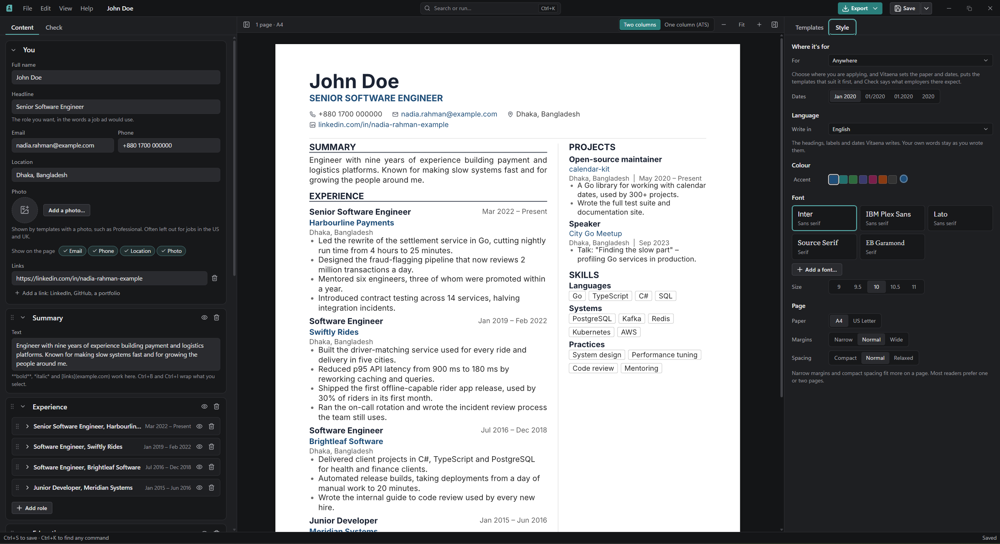
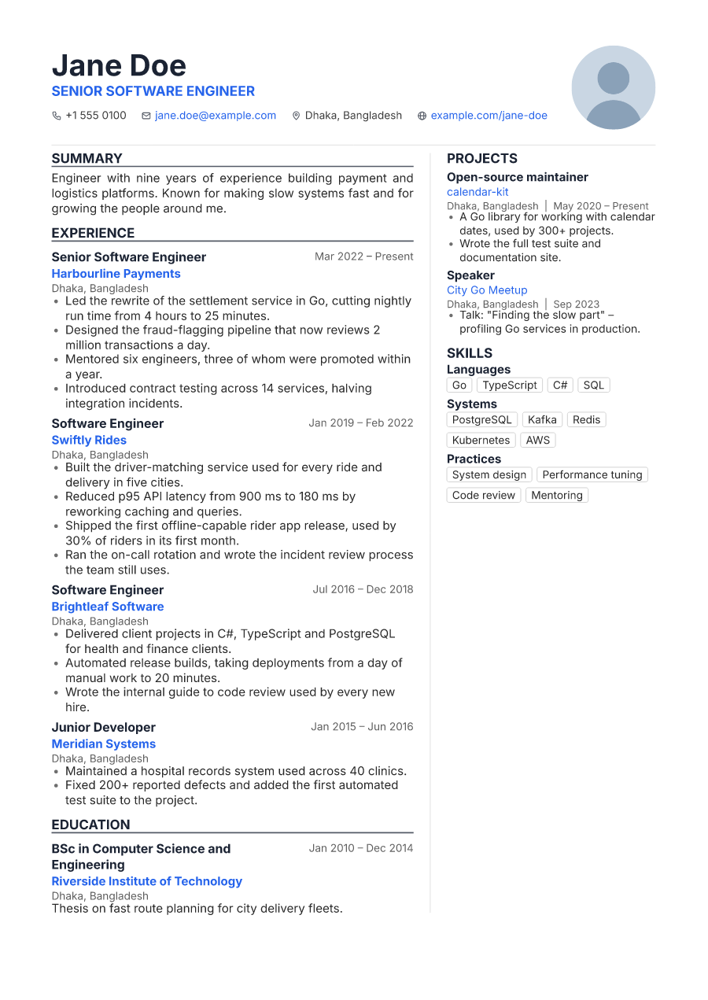
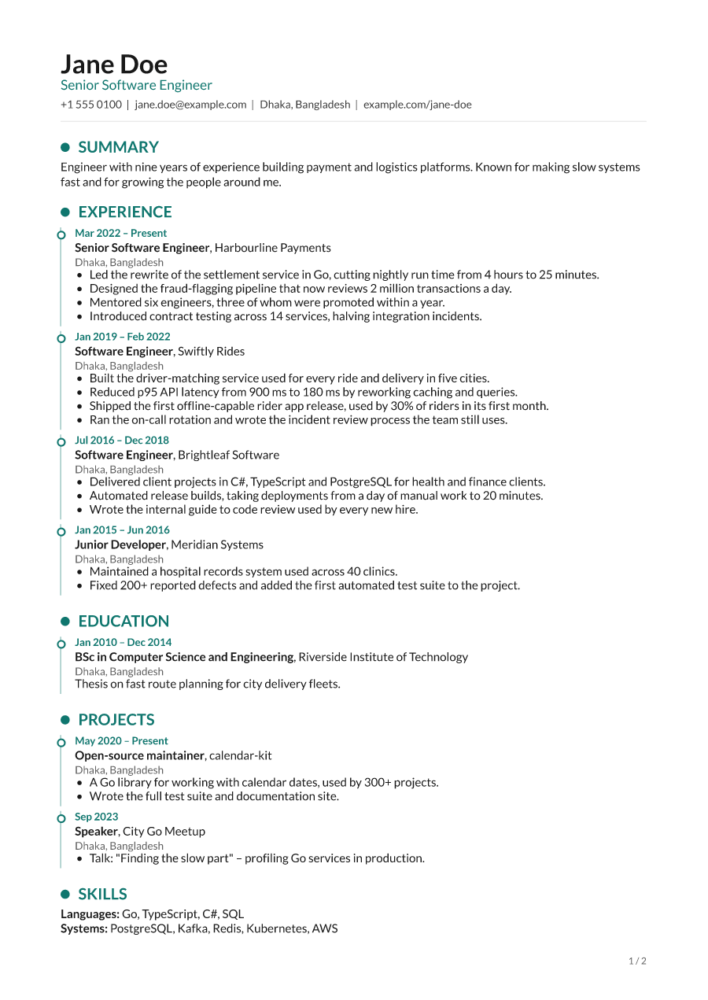
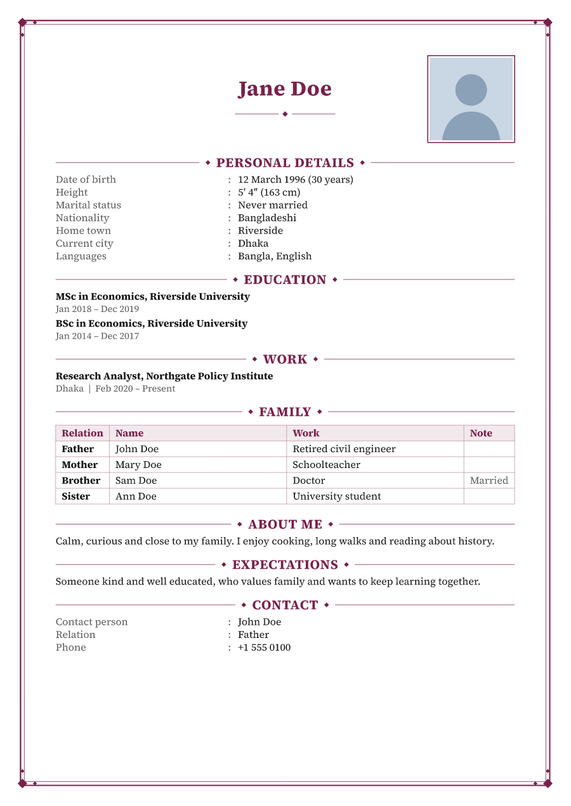

<div align="center">
  
  <h1>Vitaena</h1>
  <p><strong>A private, offline CV, resume and biodata builder for the desktop, in your own language.</strong></p>
</div>

<p align="center">
  <a href="https://github.com/AHS12/vitaena/releases">
    
  </a>
  <a href="https://github.com/AHS12/vitaena/releases/latest">
    
  </a>
  <a href="https://github.com/AHS12/vitaena/stargazers">
    
  </a>
  <a href="https://github.com/AHS12/vitaena/actions/workflows/release.yml">
    
  </a>
  <a href="https://github.com/AHS12/vitaena/actions/workflows/ci.yml">
    
  </a>
  <a href="https://github.com/AHS12/vitaena/actions/workflows/ci.yml">
    
  </a>
  <a href="https://github.com/AHS12/vitaena/actions/workflows/ci.yml">
    
  </a>
  <a href="https://github.com/AHS12/vitaena/actions/workflows/ci.yml">
    
  </a>
  <a href="LICENSE.md">
    
  </a>
</p>

<p align="center">
  <a href="https://github.com/AHS12/vitaena/releases/latest">
    
  </a>
  <a href="https://github.com/AHS12/vitaena/releases/latest">
    
  </a>
  <a href="https://github.com/AHS12/vitaena/releases/latest">
    
  </a>
</p>

<p align="center">
  <a href="https://vitaena.ahs12.xyz/assistants/">
    
  </a>
  
  
  
  
  
</p>

<p align="center">
  <strong><a href="https://vitaena.ahs12.xyz">vitaena.ahs12.xyz</a></strong> ·
  <a href="https://github.com/AHS12/vitaena/releases/latest">Download</a> ·
  <a href="https://vitaena.ahs12.xyz/templates/">Templates</a> ·
  <a href="https://vitaena.ahs12.xyz/biodata/">Biodata</a> ·
  <a href="https://vitaena.ahs12.xyz/languages/">Languages</a> ·
  <a href="https://vitaena.ahs12.xyz/assistants/">AI assistants</a> ·
  <a href="CHANGELOG.md">What's new</a>
</p>

Write your CV, resume or marriage biodata on your own computer: no account, no tracking,
no watermark, and nothing leaves it unless you back it up to storage of your own.



## Features

- **Real pages as you type,** laid out by the same engine that makes the PDF.
- **Twelve CV templates and three biodata designs,** each tested the way screening software
  reads a PDF, with a Check tab that shows what it gets.
- **Twenty-one languages:** English, German, French, Spanish, Italian, Portuguese, Dutch,
  Polish, Turkish, Russian, Ukrainian, Bangla, Hindi, Marathi, Urdu, Arabic, Persian,
  Japanese, Chinese and Korean, right to left where needed, with fonts for each or your own.
- **Import** a CV or biodata from a PDF or Word file.
- **Export** a PDF, a one-column PDF, Word, plain text, or pictures of a biodata.
- **Backups** to a folder, a file, or your own S3-compatible cloud storage.
- **Your AI assistant,** such as Claude, Copilot or a model on your own computer, can
  work on your documents over MCP, when you allow it in Settings.

Everything else is on the [website](https://vitaena.ahs12.xyz), with pages for
[languages](https://vitaena.ahs12.xyz/languages/) and [AI assistants](https://vitaena.ahs12.xyz/assistants/).

<picture>
  <source media="(prefers-color-scheme: dark)" srcset="docs/assets/screens/home-dark.png">
  
</picture>

## Templates

| Classic | Modern | Professional | Sidebar | Bold |
|---|---|---|---|---|
|  |  |  |  |  |

| Executive | Timeline | Minimal | Compact | Academic |
|---|---|---|---|---|
|  |  |  |  |  |

### Biodata

| Heritage | Clean | Portrait |
|---|---|---|
|  |  |  |

## Install

Download the file for your system from the
[latest release](https://github.com/AHS12/vitaena/releases/latest):

| System | File |
|---|---|
| Windows 10 and 11 | `vitaena-X.Y.Z-windows-amd64-setup.exe` |
| macOS 12 or later, Apple silicon and Intel | `vitaena-X.Y.Z-mac-universal.dmg` |
| Ubuntu, Debian and others | `.deb` |
| Fedora, openSUSE and others | `.rpm` |
| Arch and others | `.pkg.tar.zst` |
| Any Linux from 2024 on | `.AppImage` |

The app isn't signed yet, so Windows and macOS warn the first time you open it. The
[install guide](https://vitaena.ahs12.xyz/install/) shows the way past each warning.
Vitaena updates itself on Windows, macOS and the AppImage.

## Build from source

Needs Go 1.26, Node 22, pnpm and the [Wails 3](https://v3.wails.io) CLI. On Linux, also the
GTK 4 and WebKitGTK 6 development packages (`libgtk-4-dev libwebkitgtk-6.0-dev` on
Debian and Ubuntu).

```bash
make install   # frontend packages and git hooks
make dev       # the desktop app with hot reload
make check     # every lint, test and build check
make help      # every other task
```

[AGENTS.md](AGENTS.md) and [CONTRIBUTING.md](CONTRIBUTING.md) describe how the code is
arranged.

## Licence

[MIT](LICENSE.md). Every font, bundled or downloaded, is under the [SIL Open Font License 1.1](https://openfontlicense.org).
