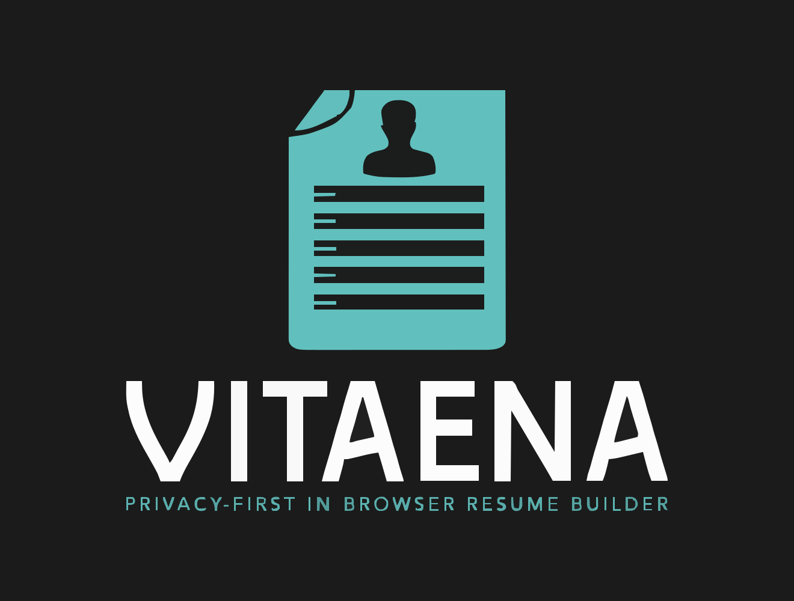

<div align="center">
  
</div>

# Vitaena - In browser local Resume Builder

**Create professional resumes in your browser. All data stays in your browser - no cloud, no tracking.**

Vitaena is a privacy-first resume builder that runs entirely in your browser. Your personal information never leaves your device, ensuring complete privacy and security.

## Why Vitaena?

- **Privacy First**: No data collection, no tracking, no external servers
- **Offline Capable**: Works without internet connection once loaded
- **No AI Text Generation**: You write all your content - no AI writes your resume for you
- **Professional Quality**: Clean, watermark-free output
- **Open Source**: Transparent, community-driven development

## Features

- 🔒 **100% Local** - All data stays in your browser
- 📱 **Responsive Design** - Works on desktop, tablet and mobile
- 🎨 **Multiple Templates** - Choose from beautiful resume templates
- 📄 **PDF Export** - High-quality PDF generation
- 🌙 **Dark Mode** - Easy on the eyes
- 🔄 **Import/Export** - Backup and restore your data
- 🚫 **No AI Text Generation** - You write all your content, no AI writes for you
- ✨ **No Watermarks** - Clean, professional output

## Getting Started

First, install dependencies:

```bash
pnpm install
```

Then, run the development server:

```bash
pnpm dev
```

Open [http://localhost:3000](http://localhost:3000) with your browser to see the result.

## Tech Stack

- **Framework:** Next.js 15 with App Router
- **Language:** TypeScript
- **Styling:** Tailwind CSS v4
- **UI Components:** Material UI (MUI)
- **State Management:** Zustand
- **Storage:** IndexedDB with Dexie.js
- **PDF Export:** Puppeteer
- **Icons:** Lucide React

## Development

### PWA and Offline Testing

Vitaena is a Progressive Web App (PWA) that works offline. For development and testing:

#### Development Scripts

```bash
# Regular development (PWA disabled)
pnpm dev

# Development with PWA enabled
pnpm dev:pwa

# Build for production
pnpm build

# Test offline functionality
pnpm build && pnpm start
```

#### Debug Tools

Access the PWA debug console at `/debug` to:

- Check service worker status
- View cache contents
- Test offline navigation
- Force cache specific URLs
- Monitor PWA functionality

The debug utility is also available in the browser console as `window.offlineDebug`.

### Privacy

Vitaena is built with privacy in mind:

- No data collection or tracking
- No external API calls for resume data
- All information stored locally in your browser
- No account registration required
- No AI text generation or processing of your personal data
- No watermarks on exported documents

## Contributing

Contributions are welcome! Please feel free to submit a Pull Request.

### Development Setup

1. Fork the repository
2. Clone your fork: `git clone https://github.com/ahs12/vitaena.git`
3. Install dependencies: `pnpm install`
4. Start the development server: `pnpm dev`
5. Make your changes
6. Test your changes thoroughly
7. Submit a pull request

### Guidelines

- Follow the existing code style and conventions
- Use TypeScript with strict typing
- Test your changes on both desktop and mobile
- Ensure privacy features remain intact
- Add appropriate documentation for new features

## License

This project is licensed under the MIT License - see the [LICENSE](LICENSE) file for details.
