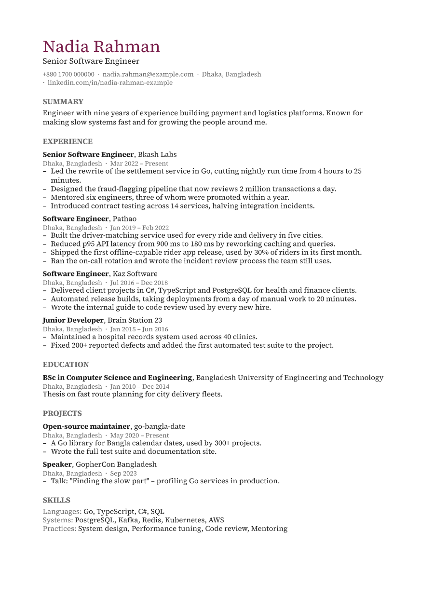

# Vitaena

**A private, offline CV and resume builder for the desktop.** Everything stays on your
computer: no account, no cloud, no tracking, and no AI writing for you.

| Classic | Modern | Professional | Sidebar | Bold |
|---|---|---|---|---|
|  |  |  |  |  |

| Executive | Timeline | Minimal | Compact | Academic |
|---|---|---|---|---|
|  |  |  |  |  |

Vitaena 2 is a rework of the [web version](https://github.com/AHS12/vitaena/tree/v1-web) as a
desktop app. Pages are laid out by [Typst](https://typst.app), running inside the app, so
long CVs break across pages properly and the PDF matches the preview exactly. No browser
engine or server is needed to make a PDF.

- Live preview of real pages, with page numbers and the name repeated from page 2
- Ten templates, five fonts, any accent colour, margins, spacing, A4 or US Letter
- Drag to reorder everything; month picker, skill chips, a proper bullet editor
- Bold, italic and links; keep details but leave them off the page
- Export PDF, Word or plain text
- A Check tab that shows what a screening system reads from your PDF, with advice
- Opens CVs exported from the web version

Templates are tested the way an applicant tracking system reads them: each one is laid out,
its text is pulled back out of the PDF, and the test checks the reading order, contact
details, dates and every bundled font.

## Developing

Needs Go 1.26, Node 20+, pnpm and the [Wails 3](https://v3.wails.io) CLI.

```bash
make install   # frontend packages and git hooks
make dev       # the desktop app with hot reload
make check     # every lint, test and build check
make previews  # pictures of the sample CV in every template
make icons     # the app icon files, from the SVGs
make installer # the Windows installer (needs NSIS)
```

[AGENTS.md](AGENTS.md) and [CONTRIBUTING.md](CONTRIBUTING.md) describe how the code is
arranged.

## Licence

MIT. The bundled fonts (Inter, IBM Plex Sans, Lato, Source Serif 4, EB Garamond) are under
the SIL Open Font License 1.1.
