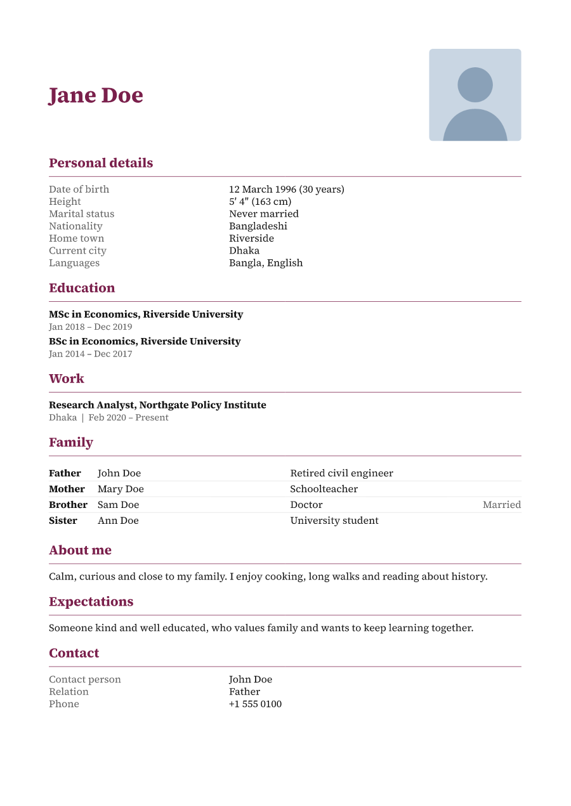
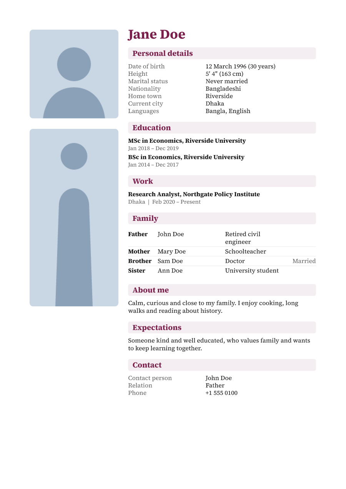
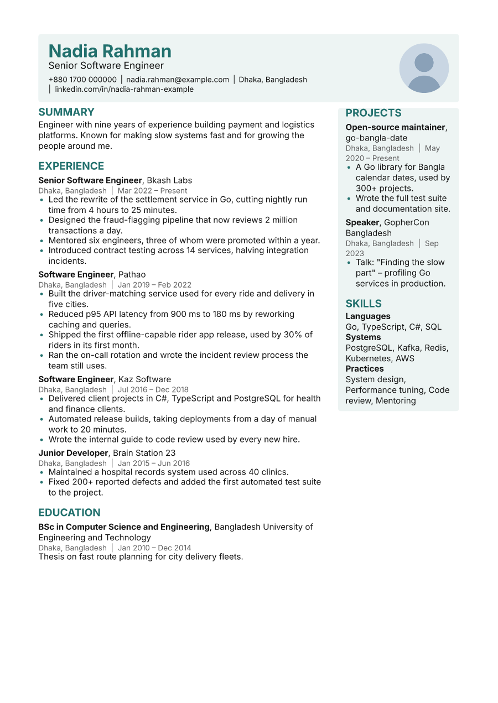
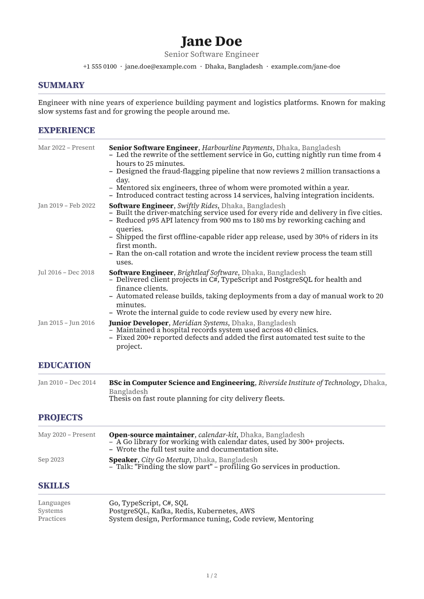

# Vitaena

**A private, offline CV, resume and biodata builder for the desktop.** Your work stays on your
computer: no account and no tracking, and nothing leaves it unless you back it up to
storage of your own. Vitaena runs on Windows, macOS and Linux.


## Features

- **Real pages as you type.** The preview is the PDF: page breaks, page numbers and the
  name repeated on every page, however long the CV runs.
- **Ten templates,** each shown with your own CV, for a resume, an academic CV, or both.
- **Made to get through screening.** Every template is tested the way an applicant
  tracking system reads a PDF. The Check tab shows the text a parser gets from yours,
  with plain advice; two-column templates switch to one column in a click.
- **Write it your way.** Drag anything into order, pick months from a calendar, type
  skills as chips, add bold, italics and links, and keep details without printing them.
- **Photos and levels.** Add a photo to templates that suit one, and show how well you
  know a language or skill as dots, a bar or squares.
- **Style.** Five fonts, any colour, text size, margins, spacing, A4 or US Letter.
- **Export** a PDF, a one-column PDF for online forms, a Word file, plain text, or a
  Vitaena file to move a CV to another computer.


## Biodata

A marriage biodata, as families in Bangladesh, India, Pakistan and Nepal make and share
one: a page or two about you and your family. Online makers keep a family's details and
photos on their servers; Vitaena keeps them on your computer.

- **Your own heading.** An optional line above your name, in your own words, and a small
  picture of your choosing. The app never suggests one.
- **Details your way.** Rows of a label and a value: rename, reorder, hide or remove any of
  them. Your date of birth shows as the date, your age, or both, and your height in feet
  and inches, centimetres, or both.
- **Your family** in rows of relation, name, work and a note, such as Married.
- **Ready sets** of labels to add in one click: Horoscope, Religious practice, Lifestyle
  and More about me. They hold labels only; what you write is up to you.
- **Two photos:** a main one every template shows, and a full-length one.
- **Check** asks for what families look for first, warns past two pages, and says when
  the text would be too small once a chat app shrinks the picture.
- **Share it** as a PDF, a picture of each page (PNG or JPG) for a chat, or a Word file.

| Heritage | Clean | Portrait |
|---|---|---|
|  |  |  |

## Your work is safe

- **Nothing is lost by closing.** While you work, everything is kept as a draft. If the
  app or the computer closes before you save, Home offers to pick up where you left off.
- **Removing isn't for good.** A removed CV goes to Recently removed for 30 days, and
  Undo brings it straight back.
- **Back up to a folder** of your choosing, such as one your cloud drive syncs. The app
  makes a dated backup once a day when something has changed, and keeps the last 5, 10,
  20 or 30.
- **Back up to a file:** a .zip of all your work, saved wherever you like.
- **Back up to your own cloud storage:** Cloudflare R2, Backblaze B2, Amazon S3, Wasabi,
  DigitalOcean Spaces, MinIO, or any other S3-compatible service, by hand or
  automatically. Your keys are kept in the system's own keychain (Windows Credential
  Manager, the macOS Keychain, or GNOME Keyring or KWallet on Linux), never in a file.
- **Restore** from any of them. You see what's in the backup first, and nothing replaces
  what you have: a CV that differs comes back as a second copy beside yours.
- **Your folder.** Choose where your work is saved, and see how much space it takes.

## Around the editor

- **Your library.** Every CV with a picture of its first page. Search, sort, and tick
  several at once to export or remove them together.
- **Find anything.** Ctrl+K searches every command and setting. Every shortcut can be
  changed in Settings.
- **Make it yours.** Light, dark or the system's theme, a larger or smaller interface, and
  less motion. Start on Home or on the last CV you had open.
- **In the background.** On Windows and macOS, closing or minimising can keep Vitaena in
  the tray, as you prefer.
- **Help when you need it.** A short tour of each page, hints on hover, and Report a
  problem, which fills in a GitHub issue with what the app knows, for you to check and
  send.

## Templates

| Classic | Modern | Professional | Sidebar | Bold |
|---|---|---|---|---|
|  |  |  |  |  |

| Executive | Timeline | Minimal | Compact | Academic |
|---|---|---|---|---|
|  |  |  |  |  |

## Install

Download the file for your system from the
[latest release](https://github.com/AHS12/vitaena/releases/latest).

### Windows

Run `vitaena-X.Y.Z-windows-amd64-setup.exe`. Windows 10 and 11 are supported. The
installer isn't signed yet, so SmartScreen may warn you: choose **More info**, then
**Run anyway**.

### macOS

Open `vitaena-X.Y.Z-mac-universal.dmg` and drag Vitaena to Applications. It runs on Apple
silicon and Intel Macs with macOS 12 or later. The app isn't notarised yet, so the first
time, right-click it in Applications and choose **Open**.

### Linux

Vitaena needs a distribution from 2024 or later, with GTK 4 and WebKitGTK 6: Ubuntu 24.04,
Debian 13, Fedora 40, or a current rolling release.

| Distribution | File | Install |
|---|---|---|
| Ubuntu, Debian, Mint, Pop!_OS | `.deb` | `sudo apt install ./vitaena-X.Y.Z-linux-amd64.deb` |
| Fedora, RHEL, Alma, Rocky, openSUSE | `.rpm` | `sudo dnf install ./vitaena-X.Y.Z-linux-x86_64.rpm` |
| Arch, Manjaro, EndeavourOS | `.pkg.tar.zst` | `sudo pacman -U vitaena-X.Y.Z-linux-x86_64.pkg.tar.zst` |
| Anything else | `.AppImage` | `chmod +x vitaena-*.AppImage`, then run it |

The AppImage brings its own copy of WebKitGTK, but uses the system's `bubblewrap` to
sandbox it, as most desktops already have. If it doesn't start, install `bubblewrap`.

The AppImage updates itself. With the other packages, Vitaena tells you when a new version
is out and links to it.

## Updates

Vitaena checks GitHub for a new version and, on Windows, macOS and the AppImage, installs
it when you close the app. Your CVs are kept in your own folder and aren't touched by an
update.

## Build from source

Needs Go 1.26, Node 22, pnpm and the [Wails 3](https://v3.wails.io) CLI. On Linux, also the
GTK 4 and WebKitGTK 6 development packages (`libgtk-4-dev libwebkitgtk-6.0-dev` on
Debian and Ubuntu).

```bash
make install   # frontend packages and git hooks
make dev       # the desktop app with hot reload
make check     # every lint, test and build check
make previews  # pictures of the sample CV and biodata in every template
make icons     # the app icon files, from the SVGs
make installer # the Windows installer (needs NSIS)
```

Linux packages are built with `wails3 task linux:package` (deb, rpm and Arch) and
`wails3 task linux:appimage`.

Pages are laid out by [Typst](https://typst.app), compiled to WebAssembly and running
inside the app, so the PDF matches the preview exactly. [AGENTS.md](AGENTS.md) and
[CONTRIBUTING.md](CONTRIBUTING.md) describe how the code is arranged.

## Licence

MIT. The bundled fonts (Inter, IBM Plex Sans, Lato, Source Serif 4, EB Garamond) are under
the SIL Open Font License 1.1.
