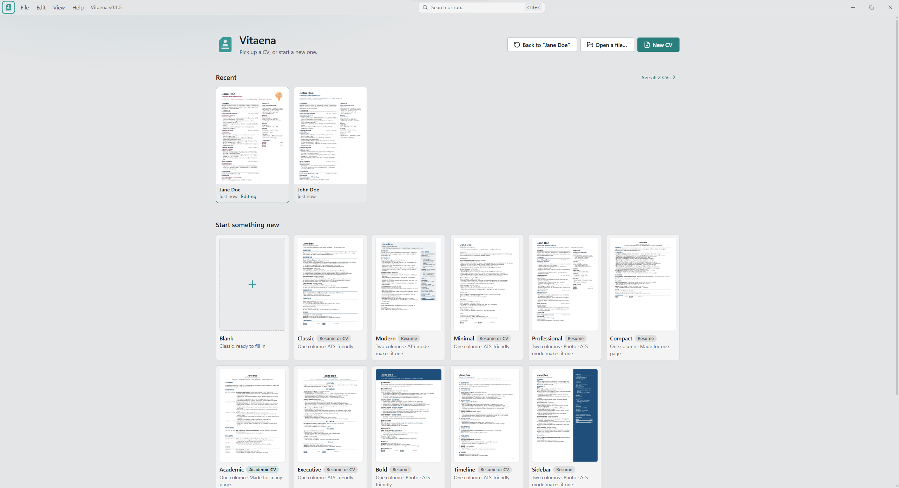
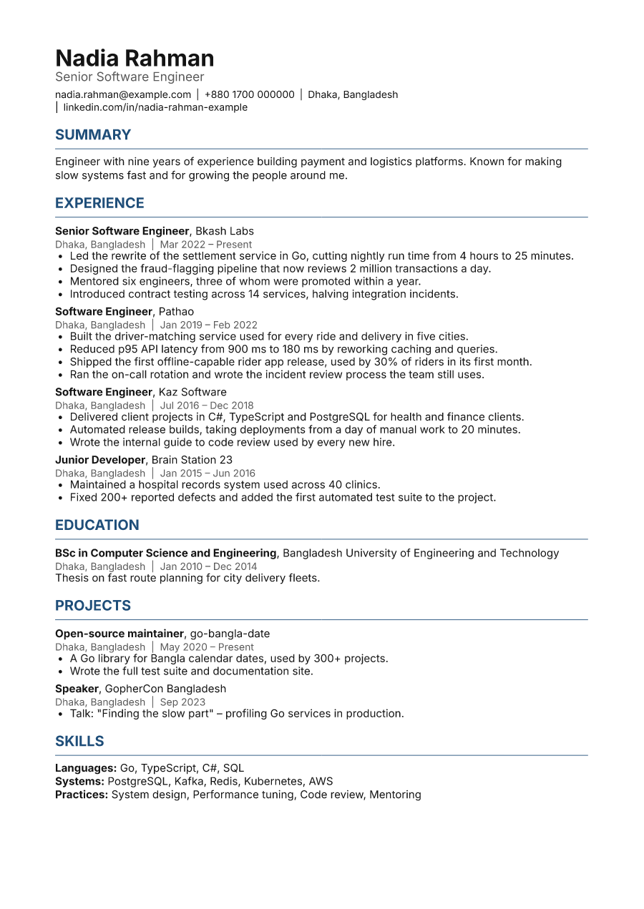
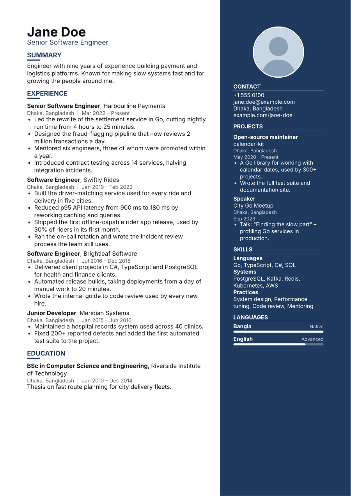
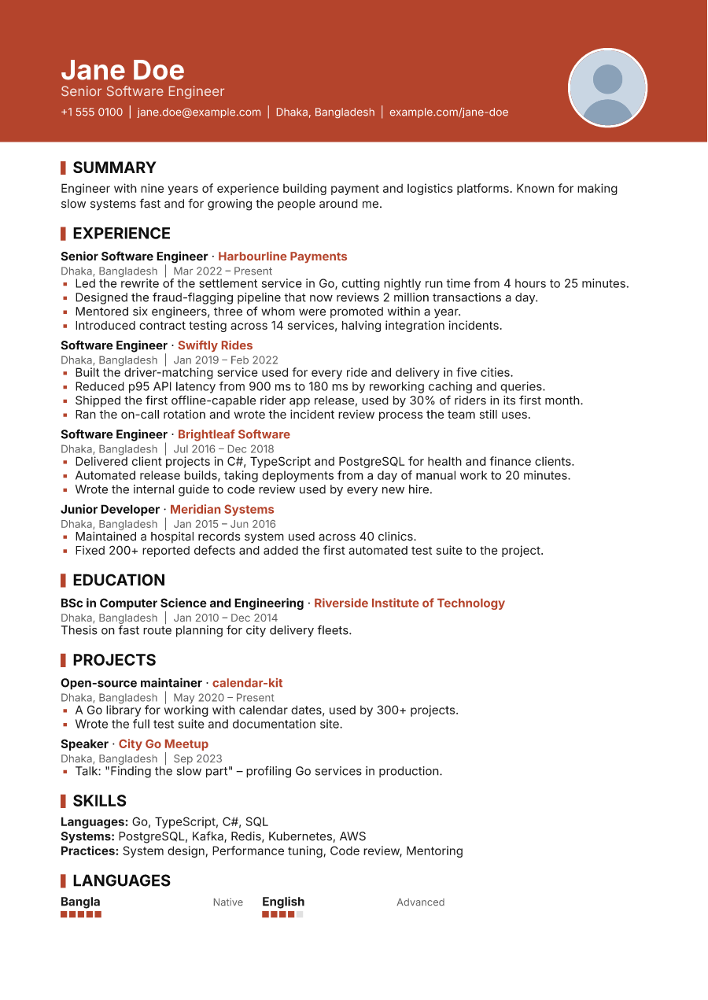

# Vitaena

**A private, offline CV and resume builder for the desktop.** Everything stays on your
computer: no account, no cloud and no tracking. Vitaena runs on Windows, macOS and Linux.


## Features

- **Real pages as you type.** The preview is the PDF: page breaks, page numbers and the
  name repeated on every page, however long the CV runs.
- **Ten templates,** each shown with your own CV, for a resume, an academic CV, or both.
- **Made to get through screening.** Every template is tested the way an applicant
  tracking system reads a PDF. The Check tab shows the text a parser gets from yours,
  with plain advice; two-column templates switch to one column in a click.
- **Write it your way.** Drag anything into order, pick months from a calendar, type
  skills as chips, add bold, italics and links, and keep details without printing them.
- **Photos and levels.** Add a photo to templates that suit one, and show how well you
  know a language or skill as dots, a bar or squares.
- **Style.** Five fonts, any colour, text size, margins, spacing, A4 or US Letter.
- **Export** a PDF, a one-column PDF for online forms, a Word file, plain text, or a
  Vitaena file to move a CV to another computer.



## Templates

| Classic | Modern | Professional | Sidebar | Bold |
|---|---|---|---|---|
|  |  |  |  |  |

| Executive | Timeline | Minimal | Compact | Academic |
|---|---|---|---|---|
|  |  |  |  |  |

## Install

Download the file for your system from the
[latest release](https://github.com/AHS12/vitaena/releases/latest).

### Windows

Run `vitaena-X.Y.Z-windows-amd64-setup.exe`. Windows 10 and 11 are supported. The
installer isn't signed yet, so SmartScreen may warn you: choose **More info**, then
**Run anyway**.

### macOS

Open `vitaena-X.Y.Z-mac-universal.dmg` and drag Vitaena to Applications. It runs on Apple
silicon and Intel Macs with macOS 12 or later. The app isn't notarised yet, so the first
time, right-click it in Applications and choose **Open**.

### Linux

Vitaena needs a distribution from 2024 or later, with GTK 4 and WebKitGTK 6: Ubuntu 24.04,
Debian 13, Fedora 40, or a current rolling release.

| Distribution | File | Install |
|---|---|---|
| Ubuntu, Debian, Mint, Pop!_OS | `.deb` | `sudo apt install ./vitaena-X.Y.Z-linux-amd64.deb` |
| Fedora, RHEL, Alma, Rocky, openSUSE | `.rpm` | `sudo dnf install ./vitaena-X.Y.Z-linux-x86_64.rpm` |
| Arch, Manjaro, EndeavourOS | `.pkg.tar.zst` | `sudo pacman -U vitaena-X.Y.Z-linux-x86_64.pkg.tar.zst` |
| Anything else | `.AppImage` | `chmod +x vitaena-*.AppImage`, then run it |

The AppImage updates itself. With the other packages, Vitaena tells you when a new version
is out and links to it.

## Updates

Vitaena checks GitHub for a new version and, on Windows, macOS and the AppImage, installs
it when you close the app. Your CVs are kept in your own folder and aren't touched by an
update.

## Build from source

Needs Go 1.26, Node 22, pnpm and the [Wails 3](https://v3.wails.io) CLI. On Linux, also the
GTK 4 and WebKitGTK 6 development packages (`libgtk-4-dev libwebkitgtk-6.0-dev` on
Debian and Ubuntu).

```bash
make install   # frontend packages and git hooks
make dev       # the desktop app with hot reload
make check     # every lint, test and build check
make previews  # pictures of the sample CV in every template
make icons     # the app icon files, from the SVGs
make installer # the Windows installer (needs NSIS)
```

Linux packages are built with `wails3 task linux:package` (deb, rpm and Arch) and
`wails3 task linux:appimage`.

Pages are laid out by [Typst](https://typst.app), compiled to WebAssembly and running
inside the app, so the PDF matches the preview exactly. [AGENTS.md](AGENTS.md) and
[CONTRIBUTING.md](CONTRIBUTING.md) describe how the code is arranged.

## Licence

MIT. The bundled fonts (Inter, IBM Plex Sans, Lato, Source Serif 4, EB Garamond) are under
the SIL Open Font License 1.1.
