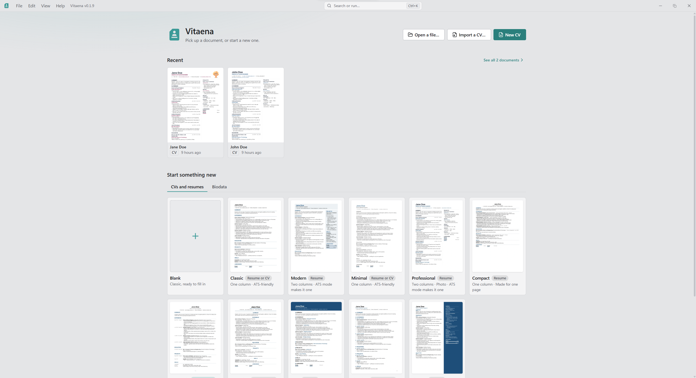
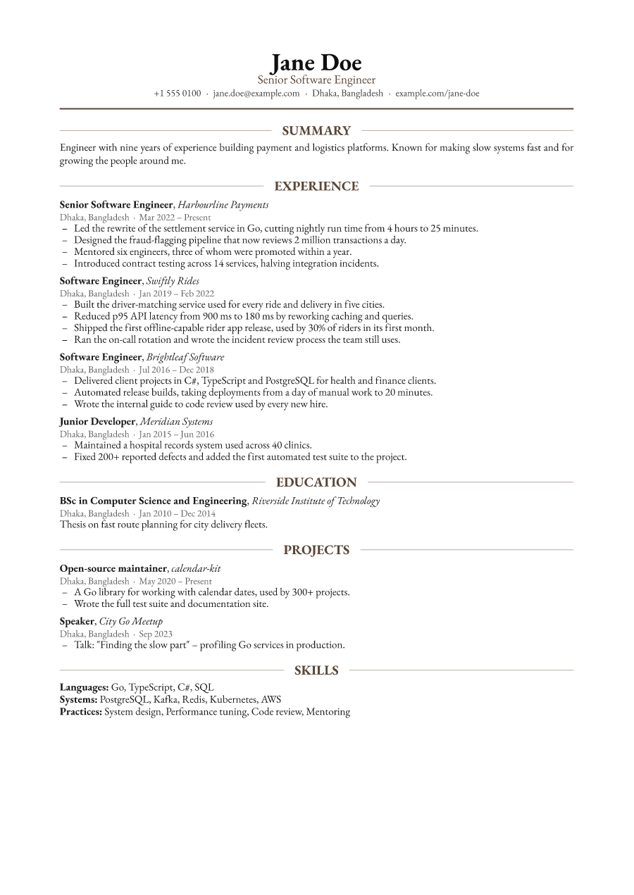
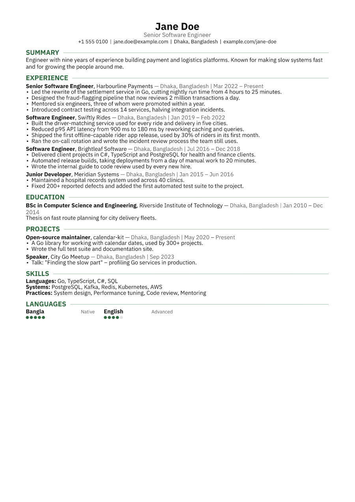

<div align="center">
  
  <h1>Vitaena</h1>
  <p><strong>A private, offline CV, resume and biodata builder for the desktop, in your own language.</strong></p>
</div>

<p align="center">
  <a href="https://github.com/AHS12/vitaena/releases">
    
  </a>
  <a href="https://github.com/AHS12/vitaena/releases/latest">
    
  </a>
  <a href="https://github.com/AHS12/vitaena/stargazers">
    
  </a>
  <a href="https://github.com/AHS12/vitaena/actions/workflows/release.yml">
    
  </a>
  <a href="https://github.com/AHS12/vitaena/actions/workflows/ci.yml">
    
  </a>
  <a href="https://github.com/AHS12/vitaena/actions/workflows/ci.yml">
    
  </a>
  <a href="https://github.com/AHS12/vitaena/actions/workflows/ci.yml">
    
  </a>
  <a href="https://github.com/AHS12/vitaena/actions/workflows/ci.yml">
    
  </a>
  <a href="LICENSE">
    
  </a>
</p>

<p align="center">
  <a href="https://github.com/AHS12/vitaena/releases/latest">
    
  </a>
  <a href="https://github.com/AHS12/vitaena/releases/latest">
    
  </a>
  <a href="https://github.com/AHS12/vitaena/releases/latest">
    
  </a>
</p>

<p align="center">
  <a href="#use-it-with-your-ai-assistant">
    
  </a>
  
  
  
  
  
</p>

<p align="center">
  <strong><a href="https://github.com/AHS12/vitaena/releases/latest">Download for Windows, macOS or Linux</a></strong> · <a href="CHANGELOG.md">What's new</a>
</p>

Your work stays on your computer: no account and no tracking, and nothing leaves it
unless you back it up to storage of your own. Write in English, Bangla, Hindi, Marathi,
Urdu, Arabic, Persian, Japanese, Chinese or Korean.


## Features

- **Real pages as you type.** The preview is the PDF: page breaks, page numbers and the
  name repeated on every page, however long the CV runs.
- **Start from the CV you have.** Import it as a PDF or a Word file and Vitaena makes it
  into a CV you can edit: your details and photo, each job with its dates and bullets,
  your skills. A biodata comes in as a biodata, with its details and family. It's read on your computer, with no AI and nothing sent anywhere; what it
  can't place waits in a hidden section for you to sort.
- **In your own language.** Eleven languages, with headings, dates and numbers written in
  each, right to left where the language runs that way, and fonts to suit.
  [More below](#in-your-own-language).
- **Ten templates,** each shown with your own CV, for a resume, an academic CV, or both.
- **Made to get through screening.** Every template is tested the way an applicant
  tracking system reads a PDF. The Check tab shows the text a parser gets from yours,
  with plain advice; two-column templates switch to one column in a click.
- **Write it your way.** Drag anything into order, pick months from a calendar, type
  skills as chips, add bold, italics and links, and keep details without printing them.
- **Photos and levels.** Add a photo to templates that suit one, and show how well you
  know a language or skill as dots, a bar or squares.
- **Style.** Five fonts for English, several for each other script, or a font of your own;
  any colour, text size, margins, spacing, A4 or US Letter.
- **Export** a PDF, a one-column PDF for online forms, a Word file, plain text, or a
  Vitaena file to move a CV to another computer.

<picture>
  <source media="(prefers-color-scheme: dark)" srcset="docs/assets/screens/home-dark.png">
  
</picture>

## Biodata

A marriage biodata, as families in Bangladesh, India, Pakistan and Nepal make and share
one: a page or two about you and your family. Online makers keep a family's details and
photos on their servers; Vitaena keeps them on your computer.

- **Your own heading.** An optional line above your name, in your own words, and a small
  picture of your choosing. The app never suggests one.
- **Details your way.** Rows of a label and a value: rename, reorder, hide or remove any of
  them. Your date of birth shows as the date, your age, or both, and your height in feet
  and inches, centimetres, or both.
- **Your family** in rows of relation, name, work and a note, such as Married.
- **Ready sets** of labels to add in one click: Horoscope, Religious practice, Lifestyle
  and More about me. They hold labels only; what you write is up to you.
- **Two photos:** a main one every template shows, and a full-length one.
- **Two languages on one page.** Each heading, label and relation can be written again
  under the first, smaller, in English or another language, as many printed biodata are.
- **Check** asks for what families look for first, warns past two pages, and says when
  the text would be too small once a chat app shrinks the picture.
- **Share it** as a PDF, a picture of each page (PNG or JPG) for a chat, or a Word file.

| Heritage | Clean | Portrait |
|---|---|---|
|  |  |  |

## In your own language

Write a CV or biodata in English, Bangla, Hindi, Marathi, Urdu, Arabic, Persian, Japanese,
Chinese (simplified or traditional) or Korean. Choose it in **Write in**, on Home or in
Style.

- **Vitaena's own words in your language:** headings, labels, relations, months, dates,
  "Present" and the comma between items. Headings and words you wrote stay as they are.
- **Right to left** for Urdu, Arabic and Persian, with two-column designs turned around to
  suit.
- **Your own digits,** such as ০১২৩ or ٠١٢٣, or 0 to 9, as you prefer.
- **Fonts to choose from** for each script, shown in your language in Style: Bangla in
  Noto, Anek Bangla, Baloo Da 2 or Tiro Bangla; Urdu in Nastaliq; Persian in Vazirmatn;
  Japanese in Noto Sans JP, M PLUS 1p or Zen Old Mincho, and more.
- **Your own font.** Add a .ttf or .otf file in Style or in Settings, Storage, and use it in
  any design. It's kept with your documents and goes into backups. Older Bijoy fonts,
  such as SutonnyMJ, store Bangla as English letters, so Vitaena asks for a Unicode font
  instead.
- **Import** a CV or biodata written in any of these languages from a PDF or Word file.

The fonts for Bangla, Hindi, Marathi, Urdu, Arabic and Persian come with the app. Those for
Chinese, Japanese and Korean are larger, so they don't: when you first choose one of these
languages, Vitaena offers to download its fonts (11 to 29 MB) from this repository's
releases, checks every file, and keeps them for every document after. Settings, Storage
lists them, to download or remove.

## Your work is safe

- **Nothing is lost by closing.** While you work, everything is kept as a draft. If the
  app or the computer closes before you save, Home offers to pick up where you left off.
- **Removing isn't for good.** A removed CV goes to Recently removed for 30 days, and
  Undo brings it straight back.
- **Back up to a folder** of your choosing, such as one your cloud drive syncs. The app
  makes a dated backup once a day when something has changed, and keeps the last 5, 10,
  20 or 30.
- **Back up to a file:** a .zip of all your work, saved wherever you like.
- **Back up to your own cloud storage:** Cloudflare R2, Backblaze B2, Amazon S3, Wasabi,
  DigitalOcean Spaces, MinIO, or any other S3-compatible service, by hand or
  automatically. Your keys are kept in the system's own keychain (Windows Credential
  Manager, the macOS Keychain, or GNOME Keyring or KWallet on Linux), never in a file.
- **Restore** from any of them. You see what's in the backup first, and nothing replaces
  what you have: a CV that differs comes back as a second copy beside yours.
- **Your folder.** Choose where your work is saved, and see how much space it takes.

## Around the editor

- **Your library.** Every CV with a picture of its first page. Search, sort, and tick
  several at once to export or remove them together.
- **Find anything.** Ctrl+K searches every command and setting. Every shortcut can be
  changed in Settings.
- **Make it yours.** Light, dark or the system's theme, a larger or smaller interface, and
  less motion. Start on Home or on the last CV you had open.
- **In the background.** On Windows and macOS, closing or minimising can keep Vitaena in
  the tray, as you prefer.
- **Help when you need it.** A short tour of each page, hints on hover, and Report a
  problem, which fills in a GitHub issue with what the app knows, for you to check and
  send.

## Use it with your AI assistant

Vitaena has no AI of its own, but an assistant you already use can work with your CVs and
biodata through it, over MCP:

- **Apps and editors:** Claude Desktop, Cursor, VS Code with Copilot, Windsurf and Zed.
- **In the terminal:** Claude Code, Codex, Gemini CLI, Qwen Code and OpenCode.
- **Open source:** OpenCode, Cline, Roo Code, Kilo Code, Continue and Goose.
- **Models on your own computer:** LM Studio, or any local AI app that runs MCP servers,
  so nothing at all leaves your computer.

Any other assistant that runs MCP servers on your computer (over stdio) works the same way.

- **Off until you allow it.** In Settings, AI assistants, choose Read only or Read and
  edit. Nothing is reachable from outside your computer, and only your assistant sees
  what it reads.
- **What it can do:** list, read and check your documents, look at their pages, make new
  ones, copy one to fit a job, change the content and the design, export any format, and
  import a CV from a PDF or Word file.
- **You stay in charge.** A change to the document you have open arrives unsaved, as a
  step you can undo. Before a saved document is changed, a copy is kept, and Settings
  lists what each assistant did, with Put back.
- **Ready-made requests:** "Fit a CV to a job" and "Review a CV or biodata", where your
  assistant shows prompts.

Settings, AI assistants gives the lines to paste for each assistant, with the path
filled in. For most, it looks like this:

```json
{
  "mcpServers": {
    "vitaena": {"command": "C:\\Program Files\\Vitaena\\vitaena.exe", "args": ["mcp"]}
  }
}
```

The assistant starts `vitaena mcp`, which reaches the running app, or starts it in the
background if it's closed.

## Templates

| Classic | Modern | Professional | Sidebar | Bold |
|---|---|---|---|---|
|  |  |  |  |  |

| Executive | Timeline | Minimal | Compact | Academic |
|---|---|---|---|---|
|  |  |  |  |  |

## Install

Download the file for your system from the
[latest release](https://github.com/AHS12/vitaena/releases/latest).

### Windows

Run `vitaena-X.Y.Z-windows-amd64-setup.exe`. Windows 10 and 11 are supported. The
installer isn't signed yet, so SmartScreen may warn you: choose **More info**, then
**Run anyway**.

### macOS

Open `vitaena-X.Y.Z-mac-universal.dmg` and drag Vitaena to Applications. It runs on Apple
silicon and Intel Macs with macOS 12 or later. The app isn't notarised yet, so macOS warns
the first time you open it. Close the warning with **Done**, then:

- **macOS 15 and later:** open **System Settings** → **Privacy & Security**, scroll down to
  the line about Vitaena, and click **Open Anyway**.
- **macOS 12 to 14:** right-click Vitaena in Applications and choose **Open**, then
  **Open** again.

### Linux

Vitaena needs a distribution from 2024 or later, with GTK 4 and WebKitGTK 6: Ubuntu 24.04,
Debian 13, Fedora 40, or a current rolling release.

| Distribution | File | Install |
|---|---|---|
| Ubuntu, Debian, Mint, Pop!_OS | `.deb` | `sudo apt install ./vitaena-X.Y.Z-linux-amd64.deb` |
| Fedora, RHEL, Alma, Rocky, openSUSE | `.rpm` | `sudo dnf install ./vitaena-X.Y.Z-linux-x86_64.rpm` |
| Arch, Manjaro, EndeavourOS | `.pkg.tar.zst` | `sudo pacman -U vitaena-X.Y.Z-linux-x86_64.pkg.tar.zst` |
| Anything else | `.AppImage` | `chmod +x vitaena-*.AppImage`, then run it |

The AppImage brings its own copy of WebKitGTK, but uses the system's `bubblewrap` to
sandbox it, as most desktops already have. If it doesn't start, install `bubblewrap`.

The AppImage updates itself. With the other packages, Vitaena tells you when a new version
is out and links to it.

## Updates

Vitaena checks GitHub for a new version and, on Windows, macOS and the AppImage, installs
it when you close the app. Your CVs are kept in your own folder and aren't touched by an
update.

## Build from source

Needs Go 1.26, Node 22, pnpm and the [Wails 3](https://v3.wails.io) CLI. On Linux, also the
GTK 4 and WebKitGTK 6 development packages (`libgtk-4-dev libwebkitgtk-6.0-dev` on
Debian and Ubuntu).

```bash
make install   # frontend packages and git hooks
make dev       # the desktop app with hot reload
make check     # every lint, test and build check
make dev-packs # the same, downloading Chinese, Japanese and Korean fonts from build/dist/font-packs
make font-packs # build those font packs, as the Font Packs workflow publishes them
make previews  # pictures of the sample CV and biodata in every template
make import-fixtures  # PDFs from other apps the import is tested on (Chrome, LibreOffice)
make icons     # the app icon files, from the SVGs
make installer # the Windows installer (needs NSIS)
```

Linux packages are built with `wails3 task linux:package` (deb, rpm and Arch) and
`wails3 task linux:appimage`.

Pages are laid out by [Typst](https://typst.app), compiled to WebAssembly and running
inside the app, so the PDF matches the preview exactly. [AGENTS.md](AGENTS.md) and
[CONTRIBUTING.md](CONTRIBUTING.md) describe how the code is arranged.

## Licence

MIT. Every font, bundled or downloaded (Inter, IBM Plex, Lato, Source Serif 4, EB Garamond,
Noto, Amiri, Vazirmatn, Nanum and the rest), is under the SIL Open Font License 1.1.
